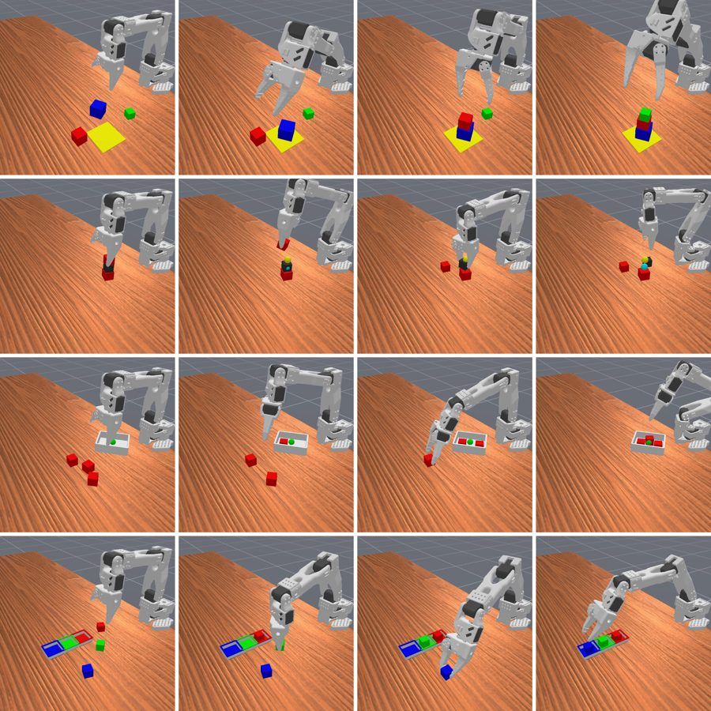
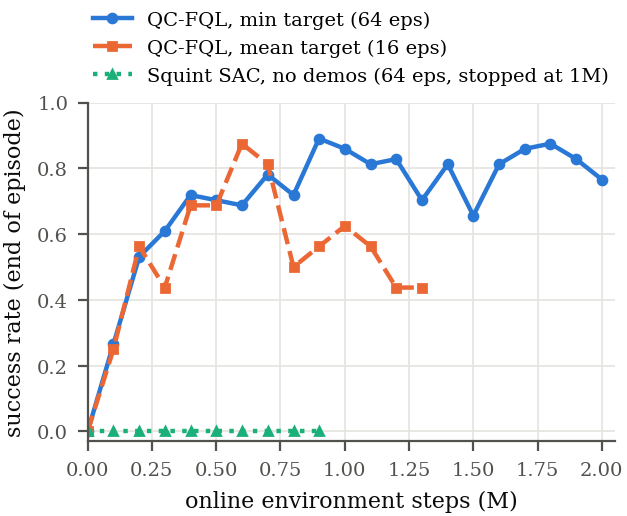

# Squint + Q-Chunking: long-horizon SO-101 manipulation

Extends [**Squint**](https://aalmuzairee.github.io/squint) (fast visual RL for sim-to-real on the SO-101 arm) to
**multi-stage tasks**: stacking, unstacking, packing and rearranging several cubes.

<p align="center"></p>

1. **Scripted demos:** a motion-planning solver performs each task in simulation and records demos.
2. **QC-FQL:** a flow policy that outputs chunks of 5 actions is pretrained on the demos, then improved with online RL.
3. **Sim-to-real:** the policy sees only a 16×16 wrist-camera image and the joint state, so it runs on the real arm.

## Results

| Task | Success |
|---|---|
| `SO101Unstack3Cube-v1` | **0.89** |
| `SO101LiftCube-v1` (domain randomization) | 0.94 |
| `SO101TrayPack1-v1` | 1.00 |
| `SO101TrayPack3-v1` | 0.12 |

<p align="center"></p>

## Installation

```bash
conda env create -f environment.yaml
conda activate squint
```

## Usage

```bash
# watch the scripted solver
ENV_ID=SO101Unstack3Cube-v1 FAST=1 bash examples/view_task.sh

# collect demos, verify them and train (Unstack3)
EXP_NAME=unstack3 EXTRA_TRAIN_ARGS="--q_agg min" bash examples/run_unstack3_qc.sh

# deploy on the real SO-101
python deploy_qc.py --checkpoint runs/unstack3/ckpt_best.pt --env_id SO101Unstack3Cube-v1
```

Checkpoints, metrics and plots are written to `runs/<run>/`. See [`QC_README.md`](QC_README.md) for how the agent
works and [`DEMOS.md`](DEMOS.md) for demo collection. The original Squint trainer (`train_squint.py`) and
deployment (`deploy.py`) work as in upstream.

## Acknowledgments

Built on [Squint](https://aalmuzairee.github.io/squint) by Abdulaziz Almuzairee and Henrik I. Christensen. The QC-FQL
agent is a PyTorch port of the official Q-chunking implementation.

```bibtex
@article{almuzairee2026squint,
      title={Squint: Fast Visual Reinforcement Learning for Sim-to-Real Robotics},
      author={Almuzairee, Abdulaziz and Christensen, Henrik I.},
      journal={arXiv preprint arXiv:2602.21203},
      year={2026}
}
```

## License

[MIT](LICENSE)
